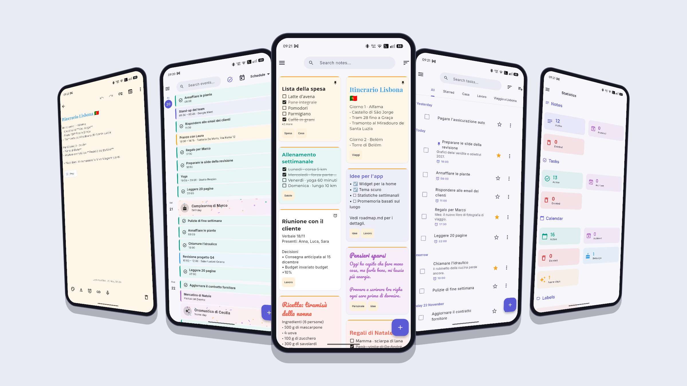
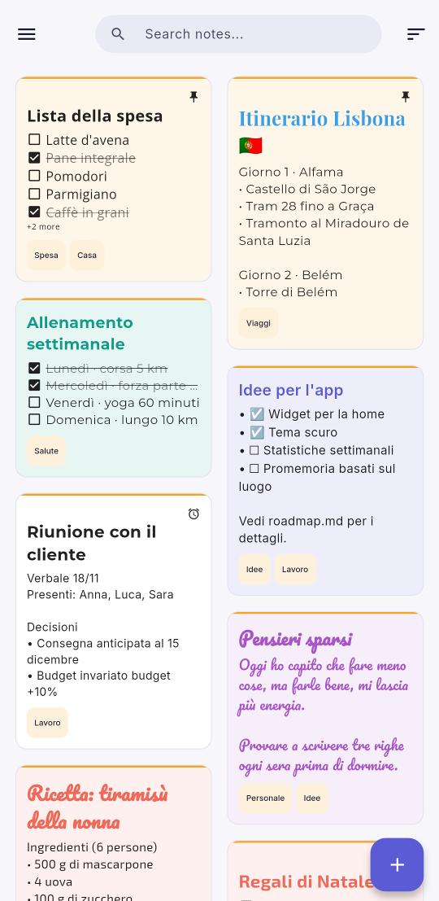
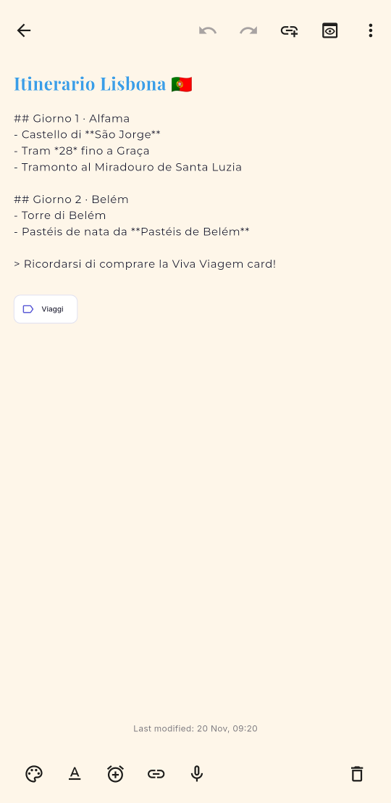
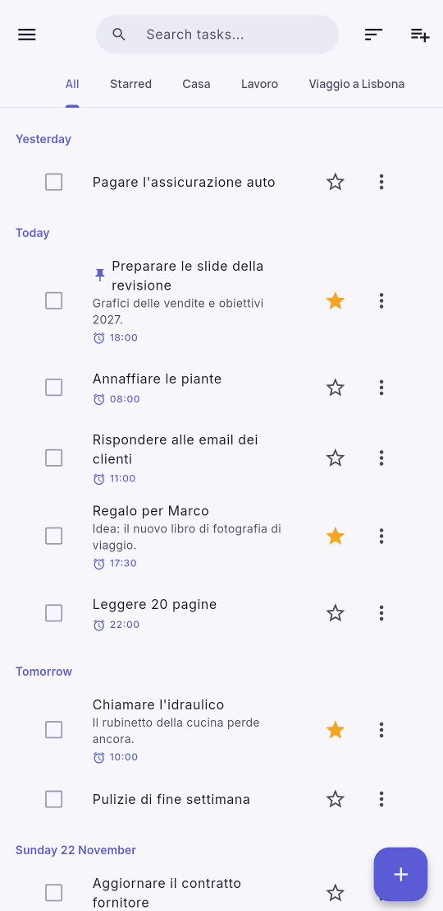
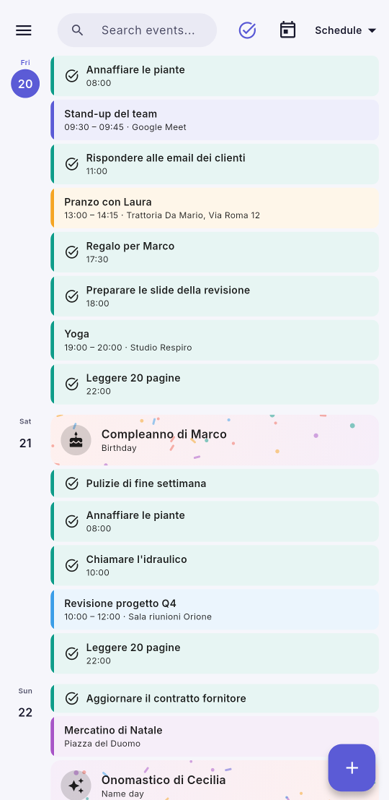
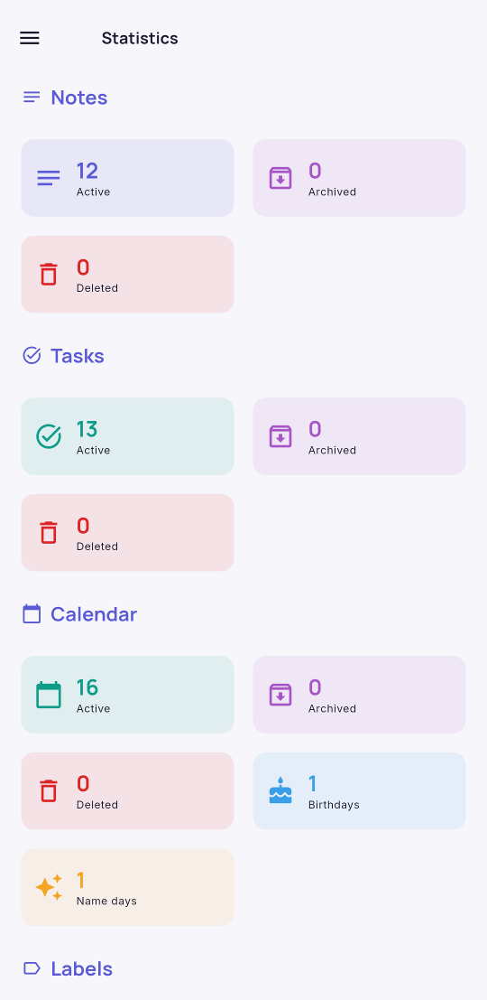

<div align="center">


# Taskenda

**Calendar, tasks and notes for Android and the web, built with Flutter.**

Your agenda, to-dos and notes in one place: calendar events, tasks with subtasks and recurrence, notes with checklists and audio, all with reminders.<br>
Synced to your account with Firebase, with backups, PDF export, Home screen widgets, Italian and English, light and dark theme.

[](https://github.com/ndenicolais/Taskenda/releases/latest)
[](#requirements)
[](https://flutter.dev)
[](LICENSE)

[**📥 Download the APK**](#download) · [**🌍 Open the web app**](https://taskenda21.web.app) · [Features](#features) · [Documentation](DOCUMENTATION.md) · [Privacy](PRIVACY.md)

<br>



</div>

---

## Screenshots

| Home | Note editor | Tasks | Calendar | Statistics |
|:---:|:---:|:---:|:---:|:---:|
|  |  |  |  |  |

---

## Features

| | |
|---|---|
| 📝 **Notes** | Text notes with a formatting bar (bold, headings, lists, checkboxes, links) and checklists, each with its own font and colors, in a grid or a list |
| 👥 **Sharing** | Add other Taskenda users to a note, task or event by email so you can edit it together, with live updates, a Shared section and a push notification when something is shared with you; pins, archive, reminders and labels stay personal |
| 🎙️ **Audio notes** | Record voice notes and play them back inside a note |
| ✅ **Tasks** | Custom lists, subtasks, due dates with an optional time, recurrence, starred and pinned tasks, grouped by day and opened in a detail view |
| 📅 **Calendar** | Day, week, month, year and schedule views, with recurring events (every N days/weeks/months, chosen weekdays, "second Tuesday of the month", single occurrences deleted), an alert before each event, birthdays and name days, Italian national holidays and observances (computed, can be switched off), locations that open in Maps, color-coded entries (or a color of your choice) and your tasks' due dates |
| ⏰ **Notifications** | Pick a day and, if you want, a time: tasks and events with a time notify at that time; all-day events can alert the day before and on the day (also when recurring); notes have their own reminder |
| 🏷️ **Labels** | Organize notes with labels and open all the notes of a label |
| 🗂️ **Archive and trash** | Archive what you don't need now, restore deleted items within 7 days |
| 📊 **Statistics** | Overview of the week, task completion, weekly activity and most used labels |
| 📤 **Export and backup** | Notes as PDF, TXT, CSV, HTML or JSON, full backups and calendar import/export in ICS |
| 📱 **Home screen widgets** | Scrolling lists of notes, tasks and upcoming calendar entries, and quick actions to create a note, task or event |
| 🔐 **Authentication** | Sign in with a Google account or email and password |
| 🔒 **End-to-end encryption** | Notes, tasks, events, labels and lists are encrypted on your device before they are saved: nobody else can read them, not even the developer, and a shared item can be read only by the people you add |
| ☁️ **Sync** | Notes, tasks, lists, labels and events are stored encrypted on Cloud Firestore, and changes made offline sync later |
| 🌍 **Web app** | The same account in the browser at [taskenda21.web.app](https://taskenda21.web.app), without reminders, voice recording, widgets and automatic backups |
| 🌍 **Multilingual** | Italian and English |
| 🌗 **Theme** | System / Light / Dark theme |
| ⚙️ **Settings** | Choose the section the app opens on and the time of all-day, birthday and name day alerts |

---

## Download

<a href="https://github.com/ndenicolais/Taskenda/releases/latest"></a>

Taskenda is distributed as an APK on [GitHub Releases](https://github.com/ndenicolais/Taskenda/releases), not on the Play Store. It needs Android 7.0+ on a 64-bit (arm64) device with Google Play services.

1. Download the APK on your phone and open it.
2. If asked, allow your browser or file manager to **install unknown apps**.
3. Confirm the installation.

> [!NOTE]
> **"App blocked to protect your device" (Google Play Protect).** Play Protect shows this warning for apps that are not distributed through the Play Store and whose developer it does not know yet. Tap **More details → Install anyway** to continue. The source code of every release is available in this repository.

### Web

Open [taskenda21.web.app](https://taskenda21.web.app) in a recent browser and sign in with the same account: notes, tasks and events are the same as on your phone. The web version has no reminders or notifications, no voice recording (existing recordings play back), no Home screen widgets and no automatic backups; exports are downloaded by the browser.

---

## Architecture

| Layer | Technology |
|---|---|
| Framework | Flutter 3 / Dart |
| State management | Riverpod |
| Cloud database | Cloud Firestore (with offline persistence) |
| Authentication | Firebase Auth + Google Sign In |
| End-to-end encryption | cryptography (AES-256-GCM, PBKDF2, X25519), flutter_secure_storage |
| Local persistence | SharedPreferences, app documents folder (audio, backups) |
| Fonts | Manrope (titles) and Inter (text), plus six note fonts (bundled) |
| Icons | Material Icons |
| Notifications | flutter_local_notifications, timezone |
| Audio | record, just_audio |
| Charts | fl_chart |
| Home screen widgets | home_widget + native Kotlin widgets |
| Place suggestions | Google Places API (New) Autocomplete, via the `searchPlaces` Cloud Function |
| Export | pdf, printing, share_plus, archive |
| Web hosting | Firebase Hosting |

<details>
<summary><b>Project structure</b></summary>

```
lib/
├── main.dart                  # Entry point, auth gate
├── core/                      # Version, changelog, app info, routing and deep links
├── l10n/                      # ARB localization files (it, en)
├── models/                    # Notes, tasks, lists, labels, events
├── providers/                 # Riverpod providers, one per domain
├── screens/                   # One folder per complex screen
├── theme/                     # Colors, font sizes, spacing, radii, ThemeData
├── utils/                     # Notifications, backup, ICS, audio, widgets
└── widgets/                   # Shared widgets and design-system components
```

</details>

---

## Build from source

### Requirements

- Flutter SDK 3.44 or later (Dart SDK 3.7.2 or later)
- Android 7.0+ (API 24+), 64-bit (arm64), with Google Play services
- Internet connection (for authentication and Firestore sync)
- A Firebase project with Authentication and Cloud Firestore, configured with [`flutterfire configure`](https://firebase.google.com/docs/flutter/setup): it creates `android/app/google-services.json` and `lib/firebase_options.dart` (both git-ignored)
- The Firestore security rules and indexes of this repository, published with `firebase deploy --only firestore` (sharing needs both)
- For sharing notifications: the Cloud Functions in `functions/` (Node.js 22, region `europe-west1`, Blaze plan), published with `cd functions && npm install && firebase deploy --only functions`

### Run

```bash
# Clone the repository
git clone https://github.com/ndenicolais/Taskenda.git
cd Taskenda

# Install dependencies
flutter pub get

# Run the app
flutter run
flutter run -d chrome --web-port 5000   # web (port 5000 is the authorized OAuth origin)
```

Release builds are signed with the keystore set in `android/key.properties` (see [DOCUMENTATION.md](DOCUMENTATION.md)); without it, they fall back to the debug key.

The web app is published on Firebase Hosting (`hosting` in `firebase.json`, site `taskenda21`) with the [Firebase CLI](https://firebase.google.com/docs/cli):

```bash
flutter build web --release
firebase deploy --only hosting
```

---

## Documentation

For detailed documentation of every feature, data model, screen and technical choice, see [DOCUMENTATION.md](DOCUMENTATION.md). How personal data is handled is described in the [privacy policy](PRIVACY.md).

---

## License

Copyright © 2026 Nicola De Nicolais — All rights reserved.
Released under a **source-available, non-commercial** license — see [LICENSE](LICENSE) for details.
Commercial use, including publishing on any app store, requires the author's written permission.

<div align="center">

Made by **Nicola De Nicolais** · [ndn21dev@gmail.com](mailto:ndn21dev@gmail.com) · [GitHub](https://github.com/ndenicolais)

</div>
